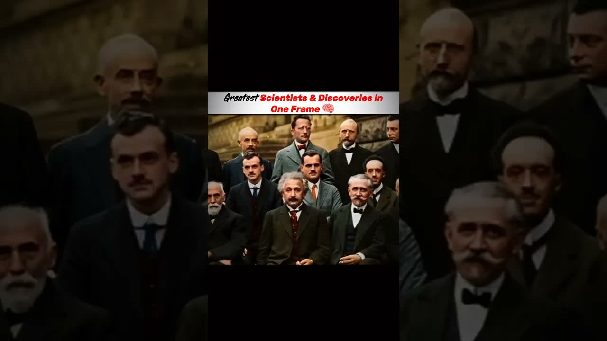

# Legends-in-One-Frame-&-Their-Great-Discoveries-🔬-#alberteinstein#PaulLangevin#Mariecurie#greatminds

  <picture>
    
  </picture>

 

---

## Video Information

| Property | Value |
|----------|-------|
| **Video Name** | `Legends-in-One-Frame-&-Their-Great-Discoveries-🔬-#alberteinstein#PaulLangevin#Mariecurie#greatminds` |
| **Original Link** | [YouTube Video](https://youtube.com/shorts/HwX5J7U5tIg?is=-HJz5qhlLMN4epBF) |
| **Total Size** | **1 file** (no split) - **2.15 MB** |
| **Quality** | **best** |
| **Status** | **Complete (100%)** |
| **Password Protected** | **NO** |

---

## Download Link

| # | File | Link |
|---|------|------|
| 1 | `Legends-in-One-Frame-&-Their-Great-Discoveries-🔬-#alberteinstein#PaulLangevin#Mariecurie#greatminds.mp4` | [Download](https://github.com/JJ1982desmond/yd_free/raw/main/videos/Legends-in-One-Frame-%26-Their-Great-Discoveries-%F0%9F%94%AC-%23alberteinstein%23PaulLangevin%23Mariecurie%23greatminds/Legends-in-One-Frame-%26-Their-Great-Discoveries-%F0%9F%94%AC-%23alberteinstein%23PaulLangevin%23Mariecurie%23greatminds.mp4) |

---

Ready to use — no extraction needed!

---
